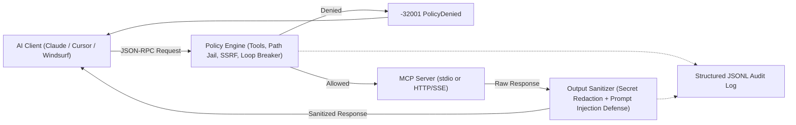

# mcp-guard

**Local security firewall and capability sandbox ("Little Snitch + WAF") for Model Context Protocol (MCP) servers.**

`mcp-guard` sits transparently between your AI client (Claude Code, Cursor, Windsurf, Claude Desktop) and any `stdio` or `SSE` / Streamable HTTP MCP server—enforcing least-privilege policies, path jails, SSRF blocks, secret redaction, prompt-injection defense, and loop breaking in real time without modifying a single line of server code.

---

## Why `mcp-guard`?

By default, every MCP server you attach inherits your full user permissions: it can read `~/.ssh`, `~/.aws`, `.env`, make arbitrary outbound network requests, execute shell commands, or smuggle prompt injections into your LLM's context window via external tool outputs.

`mcp-guard` intercepts JSON-RPC 2.0 frames at the transport layer and enforces deterministic security controls before requests reach the server and before responses reach the model.

---

## Architecture

```
+-------------------+        JSON-RPC 2.0        +----------------------------------------+        JSON-RPC 2.0        +--------------------+
|  AI Client        | -------------------------> |               mcp-guard                | -------------------------> |  MCP Server        |
|  Claude / Cursor  |                            |  [Policy Engine] -> [Rate/Loop Guard]  |                            |  stdio / SSE / HTTP|
|  Windsurf         | <------------------------- |  [Audit JSONL]  <- [Output Sanitizer]  | <------------------------- |  (Untrusted)       |
+-------------------+   -32001 PolicyDenied or   +----------------------------------------+   Raw tool output          +--------------------+
                        Sanitized Response
```



---

## Installation

One-line install from GitHub (requires Rust 1.80+):

```bash
cargo install --git https://github.com/markankamaransheogarat-sys/mcp-guard
```

Or build from source:

```bash
git clone https://github.com/markankamaransheogarat-sys/mcp-guard.git
cd mcp-guard
cargo build --release
```

---

## Quick Start

### 1. Generate a policy from your existing Claude / Cursor config

```bash
mcp-guard init
```

This scans `.cursor/mcp.json`, `.mcp.json`, and `claude_desktop_config.json`, importing discovered servers into `mcp-guard.toml`.

### 2. Wrap a `stdio` MCP server (Claude Code / Cursor)

```json
{
  "mcpServers": {
    "filesystem": {
      "command": "mcp-guard",
      "args": [
        "wrap",
        "--policy", "/path/to/mcp-guard.toml",
        "--server", "filesystem",
        "--",
        "npx", "-y", "@modelcontextprotocol/server-filesystem", "/workspace"
      ]
    }
  }
}
```

### 3. Proxy an `SSE` / Streamable HTTP MCP server

```bash
mcp-guard listen --bind 127.0.0.1:8787 --upstream http://127.0.0.1:3000 --policy mcp-guard.toml
```

### 4. Inspect the audit log

```bash
mcp-guard audit --tail 50
```

Example output:

```text
2026-11-14 23:01:12 ALLOW  [filesystem] tools/call (read_file) 142us
2026-11-14 23:01:14 DENY   [filesystem] tools/call (read_file) 38us — access to sensitive directory '~/.ssh' is denied by default
2026-11-14 23:01:19 REDACT [filesystem] tools/call (read_file) 310us — secret:aws_key, secret:github_token
2026-11-14 23:01:25 DENY   [filesystem] tools/call (execute_command) 19us — tool 'execute_command' is denied by policy
```

---

## Threat Matrix

| Threat | Defense in `mcp-guard` | Default Behavior |
| :--- | :--- | :--- |
| **Path Traversal** | Lexical normalization + ancestor canonicalization, null-byte rejection | Blocked (`-32001 PolicyDenied`) |
| **Symlink Escape** | Deepest-existing-ancestor `canonicalize()` jail check against `allowed_dirs` | Blocked (`allow_symlink_escape = false`) |
| **Sensitive File Access** | Hard default bans on `~/.ssh`, `~/.aws`, `~/.gnupg`, `**/.env*`, `*credentials*` | Blocked (`deny_default_sensitive = true`) |
| **Secret Exfiltration** | Streaming redaction of AWS, GitHub (`ghp_`/`gho_`), OpenAI, Anthropic, JWT, PEM keys, and high-entropy tokens | Redacted to `[REDACTED:<type>]` |
| **Prompt Injection** | Detects instruction overrides (`ignore previous instructions`, `<\|im_start\|>system`) & invisible Unicode tags (`U+E0000..U+E007F`) | Tagged (`<untrusted_mcp_output>`) or Blocked |
| **SSRF / Internal Pivoting** | Blocks `127.0.0.0/8`, `10.0.0.0/8`, `172.16.0.0/12`, `192.168.0.0/16`, `169.254.169.254`, `::1`, `localhost`, `*.internal` | Blocked (`block_private_ips = true`) |
| **Infinite Tool Loops** | Sliding-window rate limit + SHA-256 `(tool, args)` loop breaker | Blocked (`-32001 PolicyDenied`) |

---

## Policy Configuration (`mcp-guard.toml`)

See [examples/mcp-guard.toml](examples/mcp-guard.toml) for a complete example:

```toml
server = "workspace"

[tools]
allow = ["read_file", "read_multiple_files", "list_directory", "search_files"]
deny = ["execute_command", "run_shell", "delete_file"]

[paths]
allowed_dirs = ["/workspace"]
denied_patterns = ["**/*.pem", "**/*.key"]
deny_default_sensitive = true
allow_symlink_escape = false

[network]
allowed_domains = ["api.github.com", "*.docs.rs"]
block_private_ips = true

[rate_limit]
max_calls_per_minute = 120
loop_breaker_threshold = 5
loop_window_secs = 60

[sanitizer]
redact_secrets = true
detect_high_entropy = true
entropy_threshold = 4.5
prompt_injection_mode = "tag" # "tag" | "block" | "off"
```

---

## Security & Implementation Guarantees

- `#![forbid(unsafe_code)]` enforced crate-wide
- Zero `stdout` pollution in `stdio` proxy mode (diagnostics go strictly to `stderr`)
- Structured JSONL audit logging with automatic size-based rotation

## License

Dual-licensed under either of [Apache License, Version 2.0](LICENSE-APACHE) or [MIT License](LICENSE-MIT) at your option.
